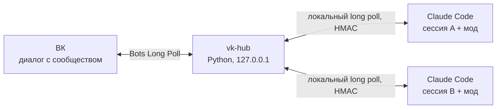

<div align="center">

# vk-alert

**ВК-мост для Claude Code. Пишешь агенту в ВК, он просыпается и отвечает туда же.**

[](https://code.claude.com/docs/en/plugins/mods/overview)
[](hub/vk_hub.py)
[](https://dev.vk.ru/ru/api/bots-long-poll/getting-started)
[](LICENSE)

</div>

---

Агенты Claude Code работают в окнах VS Code, а ты не у компьютера. С vk-alert можно продолжить диалог с телефона через обычный диалог с сообществом ВК. ВК работает и там, где мобильный интернет пускает только по белым спискам.

- **Сообщение будит агента.** Ему не нужно опрашивать ВК. Если он спит, твоё сообщение запускает новый ход так, будто ты напечатал его в терминале.
- **Мост для конкретного диалога.** Его включают в той сессии, где он нужен, а не для всего проекта сразу.
- **Ответы приходят сами.** Итог хода уходит в ВК автоматически, а для промежуточных статусов у агента есть инструмент `vk_send`.
- **Тихо, пока всё в порядке.** Обычные сообщения выглядят как простой текст. Заметная тревога появляется только при реальной проблеме.
- **Управление в одну команду.** `/vk on` и `/vk off` в сессии или `/off` с телефона.

## Как это выглядит

```text
ты        сколько тестов падает?

бот       shopper
          Падают 3 теста из 214, все в test_cart.py, причина в округлении скидки.

ты        почини и прогони заново

бот       shopper · занят, прочитаю после текущего хода. Чтобы передать сейчас, напиши force send

бот       shopper
          Исправил round() в cart.py:88, все 214 тестов проходят.

ты        ! git status --short

бот       shopper
          ! git status --short
          код 0, 1 с
           M cart.py

бот       ‼️ ПРОБЛЕМА · ltt
          Обучение упало на 3-й эпохе, на диске кончилось место. Нужно решение:
          1) удалить старые чекпоинты
          2) остановить и ждать тебя
```

Markdown агента превращается в обычный текст. Звёздочки и обратные кавычки убираются, заголовки становятся строками, списки идут с «•», таблицы разворачиваются в строки. Длинный ответ приходит частями с пометкой `(1/3)`.

## Как устроено



| Часть | Что делает |
|---|---|
| **[`hub/vk_hub.py`](hub/vk_hub.py)** | Один процесс на машину, только стандартная библиотека Python. Держит Long Poll ВК, принимает сообщения только от владельца и раскладывает их по сессиям. Сообщения агентов оформляет и отправляет в ВК, по пути вырезая токены и ключи. Запускается сам при первом `/vk on` и сам закрывается, когда мостов не остаётся. |
| **[`plugin/`](plugin/hooks/register.ts)** | [Мод Claude Code](https://code.claude.com/docs/en/plugins/mods/overview), который живёт внутри сессии. Забирает сообщения своей сессии и будит агента через `$.prompt.submit`. Итог хода отправляет обратно в ВК. Добавляет агенту инструменты `vk_bridge` и `vk_send` и команду `/vk`. |

Оба участка работают на длинных запросах, а не на частых опросах. Пока сообщений нет, модель не тратит ни одного токена.

Надёжность обеспечивают четыре механизма.
- Хаб держит сообщение, пока мод не подтвердит обработку.
- Хаб запоминает позицию Long Poll в `data/state.json` и после перезапуска дочитывает то, что пришло, пока его не было.
- Второй хаб на тот же порт не встанет.
- После `/clear` и `/resume` мод переключается на новый диалог.

## Установка

**Что нужно.** Claude Code 2.1.287 или новее, Python 3.10+, сообщество ВК. Проверено на Windows. Для macOS и Linux запуск хаба тоже предусмотрен.

### 1. Сообщество ВК

Сообщество можно завести с отдельного аккаунта, а писать со своего основного. В разделе «Управление» сообщества включи вот что.

| Где | Что включить |
|---|---|
| Сообщения | «Сообщения сообщества» |
| Сообщения → Настройки для бота | «Возможности ботов» |
| Дополнительно → Работа с API → Long Poll API | «Включено», версия 5.199, в типах событий «Входящее сообщение» |
| Дополнительно → Работа с API → Ключи доступа | ключ с доступом к сообщениям и к управлению сообществом. Управление нужно, без него ключ не подключится к Long Poll |

Потом напиши сообществу любое сообщение со своего основного аккаунта. Без этого бот не сможет писать тебе первым.

### 2. Настройки

```bash
git clone https://github.com/alekseevpavel04/vk-alert.git
cd vk-alert
cp .env.example .env
```

| Переменная | Значение |
|---|---|
| `VK_TOKEN` | ключ доступа сообщества, начинается с `vk1.a.` |
| `VK_GROUP_ID` | ID сообщества, число без минуса |
| `VK_OWNER_ID` | твой числовой VK ID. Только твои сообщения доходят до агентов |
| `HUB_PORT` | порт хаба на 127.0.0.1, по умолчанию 8765 |
| `VK_SHELL` | `1` разрешает запускать команды с телефона через `! команда`. По умолчанию выключено |

### 3. Подключить мод

Чтобы мод был во всех сессиях, добавь путь к папке `plugin` в `~/.claude/settings.json`.

```json
{
  "env": {
    "CLAUDE_CODE_PLUGIN_DIRS": "/полный/путь/к/vk-alert/plugin"
  }
}
```

Для одной сессии хватит флага `claude --plugin-dir /путь/к/vk-alert/plugin`. Мод загружается при старте сессии, поэтому уже открытые сессии нужно перезапустить, например через `claude -c`.

## Использование

### В сессии Claude Code

| Команда | Что делает |
|---|---|
| `/vk on [метка]` | включает мост, по желанию сразу с меткой |
| `/vk off` | выключает мост |
| `/vk status` | показывает, включён ли мост, метку, режим и правила |
| `/vk label shopper` | меняет метку |
| `/vk rules пиши статус после каждого этапа` | задаёт правила отчёта |
| `/vk rules clear` | стирает правила |
| `/vk mode answers\|quiet\|all` | что уходит в ВК само, см. ниже |

Можно и словами, например «включи ВК-мост», «назови мост shopper» или «пиши только при проблемах». Агент сам вызовет `vk_bridge`. Пока мост включён, под строкой ввода видна надпись `vk-bridge: ВК ● метка`.

**Метка** это одно короткое слово до 16 символов, например `shopper`, `ltt-2`, `аудит`. По умолчанию берётся имя папки проекта. Длинную метку мод и хаб сокращают сами. Если метки совпадают, хаб добавляет `-2`.

### В ВК

| Что написать | Что будет |
|---|---|
| любой текст | уйдёт единственному включённому мосту |
| ответ на сообщение агента | уйдёт этому агенту. Если его сессия уже закрыта, бот так и скажет, другому не отдаст |
| `#метка текст` | уйдёт сессии с этой меткой. Хватит начала метки, `#шоп` |
| текст без адреса при нескольких мостах | бот спросит кнопками, кому отправить |
| `стоп` | прервёт текущий ход. Без адреса остановит всех занятых |
| текст, пока агент занят | сообщения копятся и уходят агенту одним текстом, когда он закончит ход |
| `force send` или `force send текст` | отдаёт накопленное вместе с этим текстом в текущий ход, агент прочтёт его на следующем шаге |
| `! команда` | выполнит команду в bash в папке сессии, как `!` в терминале Claude Code. Вывод придёт тебе в ВК, а агент увидит его в разговоре. Работает при `VK_SHELL=1` |
| кнопка под сообщением агента | агент может прислать команду кнопкой, чтобы не переписывать её руками. Нажатие работает как `! команда`, один раз. Сами команды видны текстом под сообщением |
| `/list` | список включённых мостов, кто занят, кто свободен |
| `/off`, `/off метка`, `/off all` | выключит мосты |
| `/help` | подсказка |

Агентам доходит только текст. Про стикеры, голосовые, файлы и пересланные сообщения бот ответит, что они не передаются. Включить мост с телефона нельзя, только из окна сессии. Так к ВК не подключится случайно не тот диалог.

### Что уходит в ВК

Всё, что агент сам отправил через `vk_send`, уходит всегда. У `vk_send` два уровня.
- **Обычный.** Метка в первой строке, ниже текст.
- **Тревога** (`level: alert`). Сообщение начинается с `‼️ ПРОБЛЕМА`, и его видно ещё в списке чатов. Агент ставит её, только когда без тебя нельзя продолжать или есть риск потерять данные, деньги или доступ.

Итоги ходов уходят автоматически, по режиму.

| Режим | Что уходит автоматически |
|---|---|
| `answers`, по умолчанию | ответы на сообщения из ВК и итоги работы, которую ты запросил из ВК. Если последний запрос был с клавиатуры, фоновые задачи и таймеры в ВК не пишут |
| `quiet` | только ответы на сообщения из ВК. Это режим «только тревоги», остальное агент шлёт сам через `vk_send` по правилам отчёта |
| `all` | итог каждого хода, который начался из ВК, после фоновой задачи, по таймеру или по сообщению другой сессии |

Ходы, начатые с клавиатуры, продолжения после Stop-хуков и ходы без промпта в ВК не уходят ни в одном режиме. Если Stop-хук вернул агента к работе посреди хода, в ВК уходит ответ, написанный до обратной связи хука, а не ответ самому хуку.

Если Claude Code остановился на окне разрешения (Yes/No в терминале, например guard-хук проекта ответил `ask`), тот же вопрос приходит в ВК с кнопками «Да» и «Нет» и причиной от хука. Можно нажать кнопку или ответить словом «да» или «нет». Решает тот, кто ответил первым, в ВК или в терминале.

По умолчанию сообщения агента начинаются со строки `tl;dr: …` в 4-10 слов, дальше подробности. Правила отчёта (`/vk rules`) это меняют. Если работа займёт больше пары минут, агент сначала коротко отвечает, что понял и когда ждать итог. Пока мост включён, `AskUserQuestion` отключён. Агент задаёт вопрос в ВК с пронумерованными вариантами, а ты отвечаешь цифрой.

### Из любого скрипта

```bash
python hub/vk_hub.py notify "обучение закончилось, accuracy 0.93" --label ml
python hub/vk_hub.py notify "диск заполнен на 98%" --label ml --alert
```

## Безопасность

- **Отправитель.** Хаб принимает сообщения только от `VK_OWNER_ID` в личном диалоге, остальное отбрасывает. Агентам уходит только твой текст, без пересланного, подписей вложений и имён.
- **Локальный API.** Он слушает только `127.0.0.1`. Каждый запрос подписан HMAC с ключом из `data/hub.key`, каждый ответ хаба тоже. Процесс без доступа к ключу не может ни говорить с хабом, ни выдать себя за него. Запросы с чужим `Host` (DNS rebinding) и с `Origin` (браузер) отклоняются. Порт занимается эксклюзивно.
- **Права на файлы.** Права на `data/` (ключ, лог, позиция Long Poll) хаб сам ограничивает текущим пользователем. Проверь, что и `.env` не читают другие учётки машины.
- **Секреты.** Перед отправкой в ВК вырезаются ключи Anthropic, OpenAI, Google, HF, GitHub, GitLab, Slack, Stripe, npm, AWS, VK и Telegram, JWT, приватные ключи, пароли в URL и строки вида `token=…` и `password=…`.
- **Лог.** Тексты сообщений в него не пишутся, только их длина. Лог ротируется по 1 МБ.
- **Режим заглушки** включается только переменной окружения `VK_STUB=1`, через `.env` его не включить.
- **Транспорт.** К API ВК и к Long Poll хаб ходит только по HTTPS с проверкой сертификата. Адрес Long Poll, который вернул ВК, хаб всегда переводит на HTTPS, потому что события из него запускают работу на компьютере.
- **Команды с телефона** (`! команда`) по умолчанию выключены, включаются строкой `VK_SHELL=1`. Команду, которая пролежала дольше 10 минут (компьютер спал, сессия была закрыта), мод не выполняет. Каждая команда видна в окне сессии заметкой «ВК, команда».
- **ВК.** Всё, что пишут агенты, проходит через серверы ВК и хранится там. Кто владеет твоим аккаунтом ВК, тот командует агентами, а с `VK_SHELL=1` и компьютером. Поэтому включи двухфакторную защиту и на своём аккаунте, и на аккаунте, с которого создано сообщество: его администратор видит диалог и может писать от имени бота.

## Проверка без ВК

```bash
python tests/test_hub.py                       # 63 проверки хаба в заглушке, со своей папкой данных
(cd plugin && claude plugin test)             # 13 проверок мода: правила отправки, команды, HMAC
VK_STUB=1 python hub/vk_hub.py                 # хаб без ВК
python tests/stub_say.py "сколько файлов?"     # имитация твоего сообщения
python tests/stub_wait.py 0                    # что ушло бы в ВК
```

В Git Bash на Windows ставь `MSYS_NO_PATHCONV=1`, иначе `/команды` превратятся в пути. Лог хаба лежит в `data/hub.log`.

## Ограничения

- Мост работает, пока открыта сессия. Если закрыть окно, в ВК придёт «сессия закрыта».
- Сообщения, пришедшие во время работы агента, ждут конца хода. После `force send` агент прочтёт их на следующем шаге, но если он ждёт одну долгую команду, то только после неё.
- `стоп` прерывает ход, но команды, которые Claude Code уже перевёл в фон, продолжают работать.
- `! команда` работает не дольше 10 минут, `стоп` её не прерывает. Агента она не будит: вывод он увидит, когда ты напишешь ему следующее сообщение, как и после `!` в терминале.
- `/clear` выключает мост этой сессии.
- Моды Claude Code пока в раннем доступе, их API может меняться между версиями. Проверено на Claude Code 2.1.325.

## Структура

```text
vk-alert/
├── hub/vk_hub.py               хаб, Long Poll ВК, оформление сообщений, локальный HTTP API
├── plugin/
│   ├── .claude-plugin/plugin.json
│   ├── hooks/
│   │   ├── hooks.json
│   │   ├── register.ts         мод, команды, инструменты, пробуждение сессии
│   │   ├── forward.ts          правила, что уходит в ВК автоматически
│   │   └── crypto.ts           HMAC для подписи запросов к хабу
│   └── tests/                  тесты мода, claude plugin test
├── tests/                      тесты хаба и утилиты заглушки
└── .env.example
```

## Лицензия

[MIT](LICENSE)
