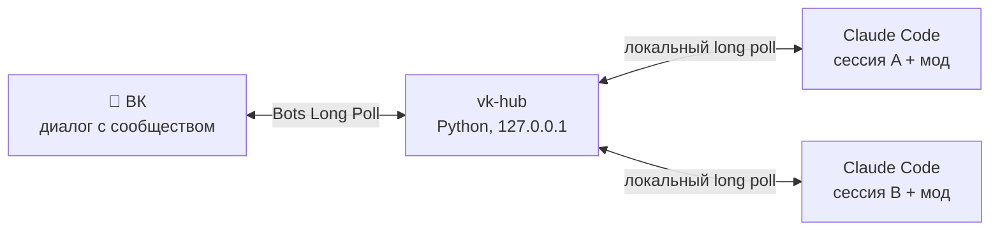

<div align="center">

# 📨 vk-alert

**ВК-мост для Claude Code. Пишешь агенту в ВК, он просыпается и отвечает туда же.**

[](https://code.claude.com/docs/en/plugins/mods/overview)
[](hub/vk_hub.py)
[](https://dev.vk.ru/ru/api/bots-long-poll/getting-started)
[](LICENSE)

</div>

---

Агенты Claude Code работают в окнах VS Code, а ты не у компьютера. С vk-alert можно продолжить диалог с телефона через обычный диалог с сообществом ВК. ВК работает и там, где мобильный интернет пускает только по белым спискам.

- **Сообщение будит агента.** Ему не нужно опрашивать ВК. Если он спит, твоё сообщение запускает новый ход так, будто ты напечатал его в терминале.
- **Мост для конкретного диалога.** Его включают в той сессии, где он нужен, а не для всего проекта сразу.
- **Ответы приходят сами.** Итог хода уходит в ВК автоматически, а для промежуточных статусов у агента есть инструмент `vk_send`.
- **Управление в одну команду.** `/vk on` и `/vk off` в сессии или `/off` с телефона.

## Как это выглядит

```text
ты в ВК    →  сколько тестов падает?
бот        ←  [shopper · Задание 2] ⏳ занят, сообщение получил, возьму после текущего шага
бот        ←  [shopper · Задание 2] Падают 3 теста из 214, все в test_cart.py, причина в округлении скидки.
ты в ВК    →  почини и прогони заново
бот        ←  [shopper · Задание 2] Исправил round() в cart.py:88, все 214 тестов проходят.
```

## Как устроено



| Часть | Что делает |
|---|---|
| **[`hub/vk_hub.py`](hub/vk_hub.py)** | Один процесс на машину, только стандартная библиотека Python. Держит Long Poll ВК, принимает сообщения только от владельца и раскладывает их по сессиям. Сообщения агентов отправляет в ВК и перед отправкой вырезает токены и ключи. Запускается сам при первом `/vk on` и сам закрывается, когда мостов не остаётся. |
| **[`plugin/`](plugin/hooks/register.ts)** | [Мод Claude Code](https://code.claude.com/docs/en/plugins/mods/overview), который живёт внутри сессии. Забирает сообщения своей сессии и будит агента через `$.prompt.submit`. Итог хода отправляет обратно в ВК. Добавляет агенту инструменты `vk_bridge` и `vk_send` и команду `/vk`. |

Оба участка работают на длинных запросах, а не на частых опросах. Пока сообщений нет, модель не тратит ни одного токена. Хаб держит сообщение, пока мод не подтвердит обработку, поэтому сообщения не теряются при перезапуске сессии или хаба.

## Установка

**Что нужно.** Claude Code 2.1.287 или новее, Python 3.10+, сообщество ВК. Проверено на Windows. Для macOS и Linux запуск хаба тоже предусмотрен.

### 1. Сообщество ВК

Сообщество можно завести с отдельного аккаунта, а писать со своего основного. В разделе «Управление» сообщества сделай следующее.

| Где | Что включить |
|---|---|
| Сообщения | «Сообщения сообщества» |
| Сообщения → Настройки для бота | «Возможности ботов» |
| Дополнительно → Работа с API → Long Poll API | «Включено», версия 5.199, в типах событий «Входящее сообщение» |
| Дополнительно → Работа с API → Ключи доступа | создай ключ с доступом к сообщениям и к управлению сообществом |

Потом напиши сообществу любое сообщение со своего основного аккаунта. Без этого бот не сможет писать тебе первым.

### 2. Настройки

```bash
git clone https://github.com/alekseevpavel04/vk-alert.git
cd vk-alert
cp .env.example .env
```

| Переменная | Значение |
|---|---|
| `VK_TOKEN` | ключ доступа сообщества, начинается с `vk1.a.` |
| `VK_GROUP_ID` | ID сообщества, число без минуса |
| `VK_OWNER_ID` | твой числовой VK ID. Только твои сообщения доходят до агентов |
| `VK_STUB` | `0` для работы с ВК, `1` для локальной заглушки без ВК |
| `HUB_PORT` | порт хаба на 127.0.0.1, по умолчанию 8765 |

### 3. Подключить мод

Чтобы мод был во всех сессиях, добавь путь к папке `plugin` в `~/.claude/settings.json`.

```json
{
  "env": {
    "CLAUDE_CODE_PLUGIN_DIRS": "/полный/путь/к/vk-alert/plugin"
  }
}
```

Для одной сессии хватит флага `claude --plugin-dir /путь/к/vk-alert/plugin`. Мод загружается при старте сессии, поэтому уже открытые сессии нужно перезапустить, например через `claude -c`.

## Использование

### В сессии Claude Code

| Команда | Что делает |
|---|---|
| `/vk on [метка]` | включает мост, по желанию сразу с меткой |
| `/vk off` | выключает мост |
| `/vk status` | показывает, включён ли мост, метку и правила |
| `/vk label Задание 2` | меняет метку, под которой сессия видна в ВК |
| `/vk rules пиши статус после каждого этапа` | задаёт правила отчёта |
| `/vk rules clear` | стирает правила |
| `/vk mode answers\|quiet\|all` | что уходит в ВК само, см. ниже |

Можно и словами, например «включи ВК-мост», «назови мост Задание 2» или «пиши статус после каждого этапа». Агент сам вызовет `vk_bridge`. Пока мост включён, под строкой ввода видна надпись `vk-bridge: ВК ● метка`.

### В ВК

| Что написать | Что будет |
|---|---|
| любой текст | уйдёт единственному включённому мосту |
| ответ на сообщение агента | уйдёт этому агенту |
| `#метка текст` | уйдёт сессии с этой меткой |
| текст без адреса при нескольких мостах | бот спросит кнопками, кому отправить |
| `стоп` | прервёт текущий ход агента |
| `/list` | список включённых мостов, кто занят, кто свободен |
| `/off`, `/off метка`, `/off all` | выключит мосты |
| `/help` | подсказка |

Включить мост с телефона нельзя, только из окна сессии. Так к ВК не подключится случайно не тот диалог.

### Что уходит в ВК

Всё, что агент сам отправил через `vk_send`, уходит всегда. Итоги ходов уходят автоматически по режиму.

| Режим | Что уходит автоматически |
|---|---|
| `answers`, по умолчанию | ответы на сообщения из ВК и итоги работы, которую ты запросил из ВК. Если последний запрос был с клавиатуры, фоновые задачи и таймеры в ВК не пишут |
| `quiet` | только ответы на сообщения из ВК. Режим «только тревоги»: остальное агент шлёт сам через `vk_send` по правилам отчёта |
| `all` | итог каждого хода, который начался из ВК, после фоновой задачи, по таймеру или по сообщению другой сессии |

Ходы, начатые с клавиатуры, продолжения после Stop-хуков и ходы без промпта в ВК не уходят ни в одном режиме. Если сказать агенту «пиши только при проблемах», он сам переключит режим на `quiet`.

- «⏳ занят», если сообщение пришло во время работы агента. Само сообщение агент обработает после текущего хода.
- Пока мост включён, `AskUserQuestion` отключён. Агент задаёт вопрос в ВК с пронумерованными вариантами, а ты отвечаешь цифрой.

То, что ты печатаешь в терминале, в ВК не дублируется.

### Из любого скрипта

```bash
python hub/vk_hub.py notify "обучение закончилось, accuracy 0.93" --label ml
```

## Безопасность

- Хаб принимает сообщения только от `VK_OWNER_ID`, остальные отбрасывает и пишет об этом в лог. Это важно, если сессии работают с `--dangerously-skip-permissions`.
- HTTP API хаба слушает только `127.0.0.1` и требует заголовок `X-VK-Hub`. Запросы с заголовком `Origin` отклоняются, поэтому страница в браузере не сможет обратиться к хабу.
- Перед отправкой в ВК хаб вырезает ключи Anthropic, VK, GitHub, Slack и AWS, JWT, приватные ключи и строки вида `token=…` и `password=…`.
- `.env` и `data/` (лог хаба) в `.gitignore`.
- Всё, что пишут агенты, проходит через серверы ВК. Учитывай это, если в проекте есть конфиденциальное.

## Проверка без ВК

```bash
python tests/test_hub.py                       # 10 проверок хаба в режиме заглушки
(cd plugin && claude plugin test)             # 6 проверок правил автоотправки мода
VK_STUB=1 python hub/vk_hub.py                 # хаб без ВК
python tests/stub_say.py "сколько файлов?"     # имитация твоего сообщения
python tests/stub_wait.py 0                    # ответы, которые ушли бы в ВК
```

В Git Bash на Windows ставь `MSYS_NO_PATHCONV=1`, иначе `/команды` превратятся в пути. Лог хаба лежит в `data/hub.log`.

## Ограничения

- Мост работает, пока открыта сессия. Если закрыть окно, в ВК придёт «💤 сессия закрыта».
- Сообщение, пришедшее во время работы агента, обрабатывается после текущего хода, а не посреди него.
- `/clear` выключает мост этой сессии.
- Моды Claude Code пока в раннем доступе, их API может меняться между версиями. Проверено на Claude Code 2.1.325.

## Структура

```text
vk-alert/
├── hub/vk_hub.py               хаб, Long Poll ВК и локальный HTTP API
├── plugin/
│   ├── .claude-plugin/plugin.json
│   └── hooks/
│       ├── hooks.json
│       ├── register.ts         мод, команды, инструменты, пробуждение сессии
│       └── forward.ts          правила, что уходит в ВК автоматически
│   └── tests/                  тесты мода, claude plugin test
├── tests/                      тесты хаба и утилиты заглушки
└── .env.example
```

## Лицензия

[MIT](LICENSE)
